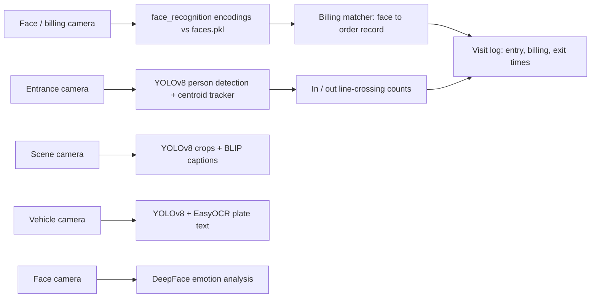

# TRINETRA
### **T**argeted **R**etail **I**nsights via **NET**worked **R**eal-time **A**nalytics

[](https://www.python.org/)
[](https://opencv.org/)
[](https://github.com)
[](LICENSE)

> **A Research-Oriented Proof-of-Concept for Multi-Camera Computer Vision Systems**

TRINETRA is an **exploratory computer vision project** investigating the feasibility, architecture, and challenges of multi-camera surveillance systems for smart retail environments. This repository documents **module-level experimentation**, system design decisions, and technical learnings from building a proof-of-concept smart monitoring pipeline using OpenCV and pre-trained vision models.

**⚠️ Note:** This is **NOT a production-ready system**. It's a research and learning project exploring the technical boundaries of computer vision in real-time, multi-camera scenarios.

---

Docs: https://the-harsh-vardhan.github.io/TRINETRA/

## What it does

- **Entrance counting**: YOLOv8 person detection with centroid tracking and a virtual line to count people in and out (`people_counter.py`)
- **Face recognition**: encodes known faces with `face_recognition` into `faces.pkl` and matches faces from a live feed
- **Billing matcher**: links a recognised face at the billing counter to an order record (order data is simulated in the script)
- **Scene description**: YOLOv8 crops captioned with BLIP for attire and objects
- **Vehicle and emotion modules**: YOLOv8 + EasyOCR for plate text, DeepFace for emotion
- **Behavioral log**: entry, billing and exit timestamps per customer (simulated visit log)

## Architecture (as implemented)



Each module is a standalone script; the modules are not yet wired into one pipeline, and billing and visit-log data are simulated.

---

## Research Objectives

This project explores key research questions in computer vision system design:

1. **Multi-Camera Coordination**: How to maintain identity consistency across multiple camera feeds with varying viewpoints?
2. **Real-Time Feasibility**: What are the computational bottlenecks when running multiple CV modules simultaneously?
3. **Model Selection Trade-offs**: Comparing accuracy vs. speed for person detection, face recognition, and re-identification models
4. **System Architecture**: Designing modular, scalable pipelines for video analytics under resource constraints
5. **Privacy-Preserving Design**: Balancing functionality with ethical data handling and privacy considerations

---

## Technical Exploration Areas

### **Core Modules Investigated**

| Module | Research Focus | Technologies Explored |
|--------|----------------|----------------------|
| **1. Entrance Counting** | Line-crossing algorithms, occlusion handling | YOLOv8, ByteTrack, Deep SORT |
| **2. Face Recognition** | Embedding quality, matching thresholds | DeepFace, FaceNet, Dlib |
| **3. Multi-Camera Tracking** | Person re-identification across viewpoints | Appearance features, trajectory mapping |
| **4. Billing Integration** | Temporal correlation, face-transaction linking | OCR (PaddleOCR), timestamp alignment |
| **5. Attire & Object Detection** | Scene understanding, captioning accuracy | CLIP, BLIP, YOLOv8 |
| **6. Behavioral Analytics** | Dwell time calculation, movement heatmaps | OpenCV tracking, spatial analysis |
| **7. Vehicle Recognition** | License plate extraction under varied conditions | OpenALPR, PaddleOCR |
| **8. Emotion Detection** | Real-world emotion classification challenges | Pre-trained CNNs, facial landmark analysis |

---

## Target System Design

The full design this project explores (modules 1-8 implement parts of it as standalone scripts; see the diagram above for what exists in code):

```
┌─────────────────────────────────────────────────────────────┐
│                     Multi-Camera Input Layer                │
│  (Entrance │ Face Capture │ Tracking │ Billing │ Vehicle)  │
└──────────────────────┬──────────────────────────────────────┘
                       │
                       ▼
┌─────────────────────────────────────────────────────────────┐
│              Modular Processing Pipeline                     │
│  ┌──────────┐  ┌──────────┐  ┌──────────┐  ┌──────────┐   │
│  │ Detection│  │ Tracking │  │ Re-ID    │  │ OCR/     │   │
│  │ (YOLO)   │  │ (SORT)   │  │ (Features)│  │ Caption  │   │
│  └──────────┘  └──────────┘  └──────────┘  └──────────┘   │
└──────────────────────┬──────────────────────────────────────┘
                       │
                       ▼
┌─────────────────────────────────────────────────────────────┐
│          Data Association & Identity Management             │
│      (Cross-camera matching, temporal correlation)          │
└──────────────────────┬──────────────────────────────────────┘
                       │
                       ▼
┌─────────────────────────────────────────────────────────────┐
│             Analytics & Insights Generation                 │
│  (Journey mapping, behavior metrics, customer profiling)    │
└─────────────────────────────────────────────────────────────┘
```

**Key Design Decisions:**
- **Modular architecture** for independent testing and iteration
- **Asynchronous processing** to handle multiple video streams
- **Fallback mechanisms** when face recognition fails (appearance-based tracking)
- **Privacy-first approach** with on-premise processing and data encryption

---

## Project Structure

```
TRINETRA/
├── 1. Entrance Count Module/                      # people_counter.py: YOLOv8 + centroid tracking + line crossing
├── 2. Face Recognition and Identification Module/ # save_new_face.py, face_recognition_main.py, faces.pkl
├── 3. Customer Journey Tracker Module/            # multi_camera_tracker.py (face-encoding step)
├── 4. Billing Counter Matcher Module/             # billing_face_matcher.py (simulated order data)
├── 5. Object and Attire Description Module/       # attire_description.py: YOLOv8 + BLIP captions
├── 6. Behavioral Insights Module/                 # behavior_analytics.py (simulated visit log)
├── 7. Vehicle Monitering Module/                  # vehicle_recognition.py: YOLOv8 + EasyOCR
├── 8. Emotion Detection Module/                   # emotion_recognition.py: DeepFace
├── Project_Description.md                         # Project objectives and module descriptions
└── Project_Proposal.txt                           # Original proposal
```

---

## Key Findings & Learnings

### **Technologies That Proved Reliable**
✅ **YOLOv8** is well-established for real-time person detection in surveillance contexts  
✅ **DeepFace with ArcFace backend** offers robust face embedding generation for identity matching  
✅ **ByteTrack** demonstrates strong tracking stability in academic literature and real-world deployments  
✅ **Modular architecture** facilitated independent module development and iterative testing  

### **Challenges Identified**
⚠️ **Cross-camera re-identification** remains an open research problem with large pose/illumination variations  
⚠️ **Real-time performance** constraints become critical when integrating multiple CV modules simultaneously  
⚠️ **Face quality in CCTV footage** is often suboptimal (low resolution, motion blur, extreme angles)  
⚠️ **Multi-camera timestamp synchronization** adds architectural complexity  
⚠️ **Privacy-preserving design** requires thoughtful trade-offs between functionality and data retention  

### **Technical Insights**
- **Person detection** is a solved problem; **person re-identification** is not
- **Embedding-based matching** outperforms raw image comparison for scalability
- **Hybrid approaches** (appearance + spatial cues) improve cross-camera tracking
- **Compute-accuracy trade-offs** are critical for real-time deployment feasibility

---

## Installation & Experimentation

### Prerequisites
```bash
Python 3.8+
CUDA Toolkit (optional, for GPU acceleration)
```

### Setup
```bash
# Clone the repository
git clone https://github.com/The-Harsh-Vardhan/TRINETRA.git
cd TRINETRA

# Create virtual environment
python -m venv venv
source venv/bin/activate  # Windows: venv\Scripts\activate

# Install dependencies
pip install opencv-python ultralytics face_recognition deepface easyocr
pip install torch torchvision transformers numpy pillow
```

### Running Modules (Example)
```bash
# Test entrance counting
python "1. Entrance Count Module/people_counter.py"

# Test face recognition
python "2. Face Recognition and Identification Module/face_recognition_main.py"

# Evaluate multi-camera tracking
python "3. Customer Journey Tracker Module/multi_camera_tracker.py"
```

**Note:** Download YOLOv8 weights (`yolov8n.pt`) from [Ultralytics](https://github.com/ultralytics/ultralytics).

---

## Limitations & Future Work

### **Current Limitations**
- Not tested on large-scale datasets (limited to synthetic + self-recorded footage)
- No distributed processing architecture for multi-camera scalability
- Privacy mechanisms implemented at design level, not rigorously validated
- Lacks robust handling of crowded scenes (>20 people)

### **Future Research Directions**
- [ ] Implement transformer-based re-identification models (ViT, CLIP-ReID)
- [ ] Explore federated learning for privacy-preserving face recognition
- [ ] Benchmark edge deployment (Jetson Nano, Raspberry Pi 5)
- [ ] Integrate temporal action detection for behavior analysis
- [ ] Add anomaly detection for security applications
- [ ] Develop synthetic data generation pipeline for privacy-safe training

---

## Privacy & Ethical Considerations

This project prioritizes **ethical AI development**:
- Face embeddings stored as 512-dim vectors (not raw images)
- Ephemeral storage with auto-deletion policies
- All processing done on-premise (no cloud transmission)
- Clear consent mechanisms for data collection
- Designed for opt-in systems only

**⚠️ Disclaimer:** This system is intended for **research and educational purposes**. Any deployment must comply with local privacy laws (GDPR, CCPA, etc.) and obtain explicit user consent.

---

## 📚 References & Inspiration

Key papers and resources that guided this exploration:

1. **Advanced Customer Behavior Tracking with YOLOv5 and DeepSORT** (Mohamed et al., 2024)
2. **Multi-Person Tracking Using Head Detection and Track Heatmaps** (Musaev et al., 2020)
3. **Deep Learning for Age, Gender, and Expression Detection in Surveillance** (Ijjina et al., 2020)
4. [Ultralytics YOLOv8 Documentation](https://docs.ultralytics.com/)
5. [DeepFace Library](https://github.com/serengil/deepface)

---

## 📄 License

MIT License — Free for educational and research use. (A LICENSE file has not been added to the repo yet; tracked in #3.)

---

## 🤝 Contributing

This is an academic project, but suggestions and discussions are welcome! Feel free to:
- Open issues for bugs or ideas
- Share your own experiments with the modules
- Propose architectural improvements

**Not accepting production deployment PRs** — this is intentionally a learning-focused POC.

---

## 📧 Contact

For questions about the research methodology or technical implementation:  
**Project Lead:** Harsh Vardhan  
**Institution:** IIIT Nagpur  

---

<div align="center">
  
**Built with curiosity, optimized for learning** 🚀

*Exploring the intersection of Computer Vision, System Design, and Real-World Constraints*

</div>
