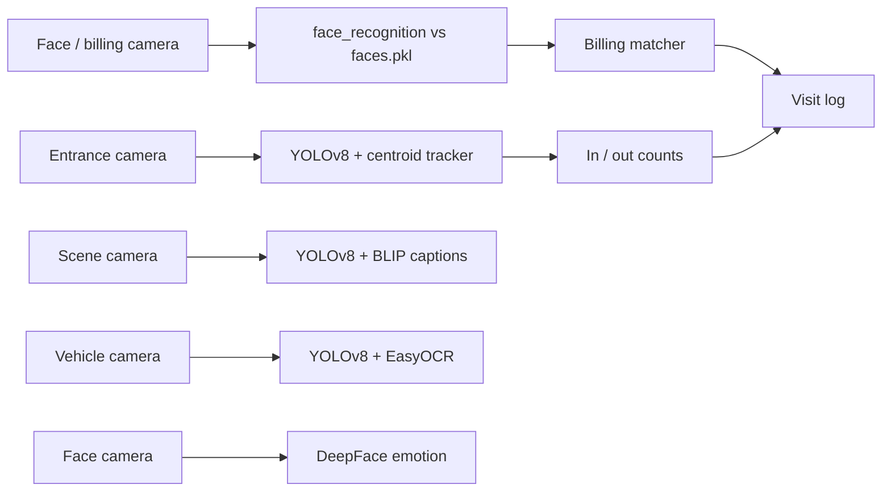

# Architecture

## Modules

| Module | Script | What it does |
|---|---|---|
| 1. Entrance Count | `people_counter.py` | YOLOv8 person class, centroid matching within 50 px, in/out by crossing a fixed line |
| 2. Face Recognition | `save_new_face.py`, `face_recognition_main.py` | Encode images from `known_faces/` into `faces.pkl`; match live faces |
| 3. Journey Tracker | `multi_camera_tracker.py` | Face-encoding step toward cross-camera identity |
| 4. Billing Matcher | `billing_face_matcher.py` | Match a face to a (simulated) order record |
| 5. Attire Description | `attire_description.py` | YOLOv8 crops captioned by BLIP |
| 6. Behavioral Insights | `behavior_analytics.py` | Simulated entry / billing / exit log |
| 7. Vehicle Monitoring | `vehicle_recognition.py` | YOLOv8 vehicle detection, EasyOCR plate text |
| 8. Emotion Detection | `emotion_recognition.py` | DeepFace emotion analysis |

The modules run independently; cross-module integration is future work.
